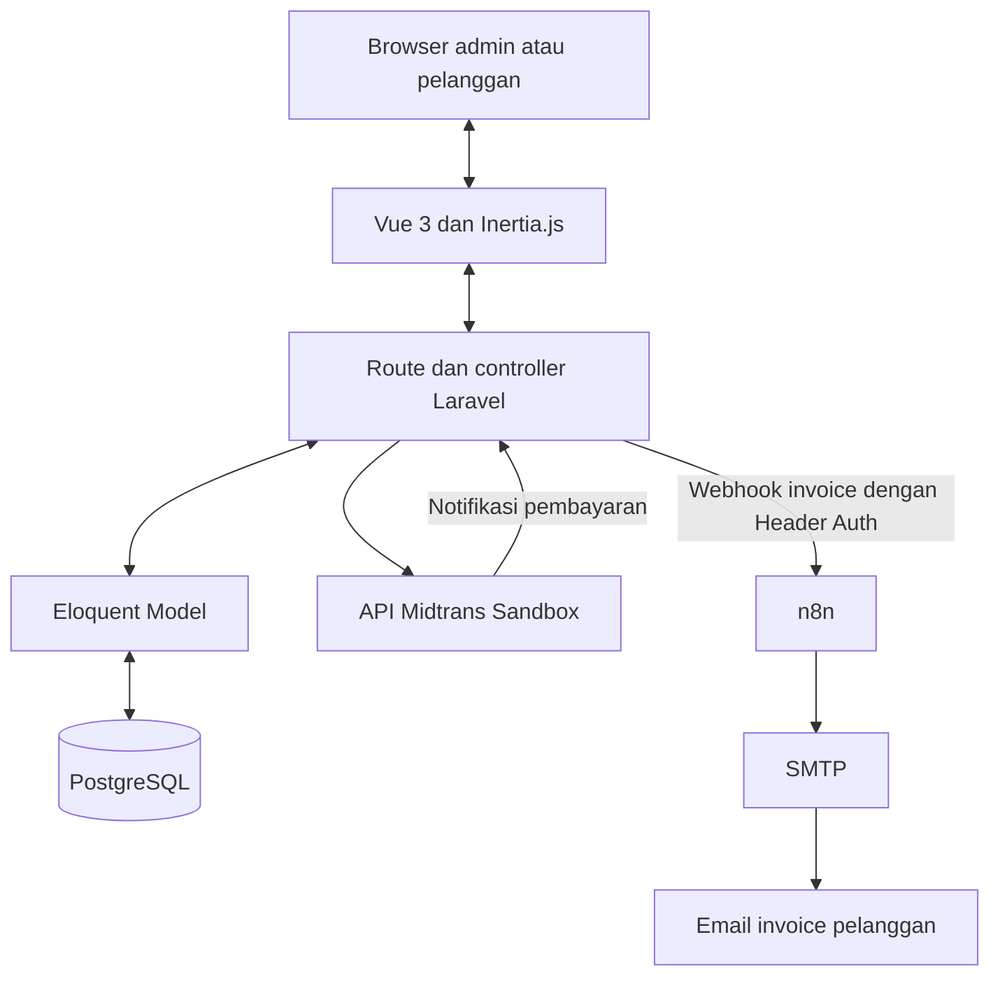

# Rental WiFi

Rental WiFi adalah aplikasi ERP sederhana untuk mengelola penyewaan perangkat
WiFi. Data paket, perangkat, pemesanan, invoice, dan pembayaran saling terhubung
agar admin tidak perlu memasukkan ulang data yang sama.

## Modul Utama

| Modul | Fitur |
| --- | --- |
| Data Master | Mengelola paket sewa, destinasi, harga per hari, serta perangkat dan status ketersediaannya. |
| Penyewaan | Mencatat pelanggan dan pemesanan, menghitung biaya sewa, membatalkan pesanan, menyerahkan perangkat, dan mencatat pengembalian. |
| Penagihan dan Pembayaran | Membuat invoice, menyediakan link invoice pelanggan, membuka pembayaran Midtrans Sandbox, dan memperbarui status pembayaran. |

Dashboard menampilkan ringkasan operasional. Pengiriman email invoice dijalankan
melalui workflow n8n setelah pemesanan tersimpan.

## Arsitektur Sistem

Aplikasi menggunakan Laravel dan Vue 3 yang dihubungkan oleh Inertia.js dalam
satu project. Laravel menangani routing, validasi, proses bisnis, dan akses
database. Vue menampilkan halaman dan form, sedangkan Inertia mengirimkan data
dari controller Laravel ke halaman Vue sebagai props.



### Pembagian Folder

| Lokasi | Tanggung jawab |
| --- | --- |
| `routes/web.php` | Mendefinisikan URL aplikasi, middleware login, dan endpoint notifikasi Midtrans. |
| `app/Http/Controllers/Dashboard` | Menangani paket, perangkat, pemesanan, invoice, dan pembayaran. |
| `app/Models` | Menyimpan model Eloquent dan relasi antar data. |
| `database/migrations` | Mendefinisikan struktur tabel database. |
| `resources/js/Pages` | Menyimpan halaman Vue yang ditampilkan melalui Inertia. |
| `resources/js/Layouts` | Menyimpan kerangka tampilan seperti sidebar, header, dan area isi halaman. |
| `config/services.php` | Membaca konfigurasi integrasi Midtrans dan n8n dari `.env`. |
| `n8n/invoice-created.json` | Workflow yang dapat diimpor ke n8n untuk pengiriman email invoice. |

### Alur Pemesanan dan Pembayaran

1. Admin memilih paket, perangkat yang tersedia, data pelanggan, dan periode sewa.
2. Laravel memvalidasi input dan menghitung biaya berdasarkan harga paket serta
   jumlah hari sewa. Data pelanggan, pemesanan, invoice, dan perubahan status
   perangkat menjadi `reserved` disimpan dalam transaksi database. Perangkat
   dikunci selama proses ini agar tidak dipesan bersamaan oleh dua admin.
3. Setelah transaksi tersimpan, Laravel mengirim data invoice ke webhook n8n
   melalui HTTP dengan header `X-Webhook-Token`. Node IF memeriksa apakah email
   pelanggan terisi, lalu node SMTP mengirim email berisi tombol menuju invoice.
   Gangguan n8n tidak membatalkan pemesanan yang sudah tersimpan.
4. Pelanggan membuka link invoice dengan token acak tanpa perlu login ke
   dashboard admin, lalu menekan **Bayar Sekarang** untuk menuju Midtrans.
5. Laravel memverifikasi status pembayaran melalui API Midtrans, baik dari
   notifikasi Midtrans maupun tombol cek status. Endpoint notifikasi memeriksa
   signature sebelum mengambil status dari Midtrans. Setelah pembayaran berhasil,
   invoice menjadi `paid` dan pemesanan menjadi `confirmed`.
6. Saat admin menyerahkan perangkat, status perangkat menjadi `rented`. Setelah
   dikembalikan, pemesanan menjadi `completed` dan perangkat menjadi `available`
   atau `maintenance`, sesuai kondisi pengembalian.

Integrasi API dilakukan dari backend Laravel. Server Key Midtrans dan token
webhook disimpan di `.env`, sedangkan kredensial SMTP disimpan di n8n. File
workflow di repository tidak menyertakan kredensial tersebut.

## Instalasi

Siapkan PHP 8.2, Composer 2, Node.js 22.12+ atau 24, npm, dan PostgreSQL.
Aktifkan ekstensi PHP `pdo_pgsql` dan `curl`.
Siapkan n8n dan akun SMTP untuk mengaktifkan pengiriman email invoice otomatis.

1. Buka terminal di folder project, lalu install dependensi:

   ```powershell
   composer install
   npm.cmd ci
   ```

2. Untuk instalasi baru, salin `.env.example` menjadi `.env`:

   ```powershell
   Copy-Item .env.example .env
   ```

   Jika `.env` sudah ada, gunakan file tersebut. Sesuaikan koneksi database:

   ```dotenv
   APP_URL=http://127.0.0.1:8000
   DB_CONNECTION=pgsql
   DB_HOST=127.0.0.1
   DB_PORT=5432
   DB_DATABASE=rental_wifi
   DB_USERNAME=postgres
   DB_PASSWORD=isi_password_postgresql
   MIDTRANS_SERVER_KEY=isi_server_key_sandbox_midtrans
   MIDTRANS_IS_PRODUCTION=false
   ```

   Buat database `rental_wifi` di PostgreSQL terlebih dahulu. Sesuaikan nama
   database, port, username, dan password dengan konfigurasi komputermu.
   Ambil Server Key dari **Settings > Access Keys** di dashboard Midtrans mode
   **Sandbox**. Simpan key hanya di `.env`, jangan di Vue atau GitHub.

   Setelah mengubah konfigurasi, jalankan:

   ```powershell
   php artisan config:clear
   ```

3. Pada instalasi baru, buat application key:

   ```powershell
   php artisan key:generate
   ```

   Kemudian buat tabel dan akun demo:

   ```powershell
   php artisan migrate --seed
   ```

4. Jalankan Laravel di terminal pertama:

   ```powershell
   php artisan serve
   ```

   Jalankan Vite di terminal kedua:

   ```powershell
   npm.cmd run dev
   ```

   Biarkan kedua terminal berjalan, lalu buka `http://127.0.0.1:8000`.
   Jika `npm` bisa digunakan langsung di terminalmu, kamu boleh memakai
   `npm ci` dan `npm run dev`.

### Pengaturan n8n untuk email invoice

Workflow tersedia di [n8n/invoice-created.json](n8n/invoice-created.json).
File ini tidak menyertakan credential, token, data pelanggan, atau data percobaan.
Alamat pengirim menggunakan placeholder `pengirim@example.com`.
Workflow diimpor dalam keadaan nonaktif sampai credential milik pengguna dipasang.

1. Jalankan n8n, lalu buka `http://localhost:5678`.
   Jika n8n sudah terpasang secara global melalui npm, jalankan `n8n`.
   Untuk pilihan pemasangan lain, ikuti [panduan instalasi n8n](https://docs.n8n.io/hosting/installation/).

2. Buat workflow di n8n. Pilih menu **tiga titik > Import from File**, lalu
   pilih file `n8n/invoice-created.json` dari repository ini.

3. Buat token rahasia sendiri dari terminal lokal:

   ```powershell
   php -r "echo bin2hex(random_bytes(32)), PHP_EOL;"
   ```

   Pada node **Webhook**, buat credential **Header Auth**:

   - **Name**: `X-Webhook-Token`.
   - **Value**: hasil token yang baru dibuat.

   Pilih credential tersebut pada node Webhook. Pertahankan metode `POST`,
   path `invoice-created`, dan respons **Immediately**.

4. Pada node **Send an Email**, buat dan pilih credential **SMTP** milik sendiri.
   Isi akun, password SMTP atau App Password, host, port, dan pengaturan TLS
   sesuai penyedia email. Untuk Gmail, gunakan `smtp.gmail.com`, port `465`,
   SSL/TLS aktif, dan App Password dari akun dengan Verifikasi 2 Langkah.
   Rujukan: [pengaturan Gmail di n8n](https://docs.n8n.io/integrations/builtin/credentials/send-email/gmail/).

   Ganti **From Email** dari `pengirim@example.com` menjadi alamat akun SMTP.
   Kolom **To Email** sudah menggunakan Expression:

   ```text
   {{ $json.body.customer_email }}
   ```

5. Simpan perubahan dan klik **Publish**. Salin **Production URL** dari node
   Webhook, lalu isi konfigurasi `.env` Laravel:

   ```dotenv
   N8N_WEBHOOK_URL=http://localhost:5678/webhook/invoice-created
   N8N_WEBHOOK_TOKEN=isi_token_yang_sama_dengan_header_auth
   ```

   Sesuaikan URL jika n8n berjalan di alamat atau port lain. Gunakan `/webhook/`
   untuk workflow yang sudah dipublish. URL `/webhook-test/` hanya dipakai ketika
   **Listen for test event** sedang aktif.

6. Muat ulang konfigurasi Laravel:

   ```powershell
   php artisan config:clear
   ```

7. Buat pemesanan dengan alamat email penerima yang dapat diperiksa.
   Setelah pemesanan dan invoice tersimpan, Laravel mengirim data ke n8n.
   Node **IF** meneruskan email yang terisi ke **Send an Email**.
   Jika email kosong, workflow berhenti tanpa mengirim email.

   Periksa tab **Executions** di n8n untuk melihat hasil pengiriman.
   Respons Webhook **Immediately** hanya menandakan data diterima n8n;
   keberhasilan pengiriman email diperiksa pada node Send an Email.
   Jika n8n tidak dapat dihubungi, pemesanan tetap tersimpan dan Laravel
   menampilkan pemberitahuan bahwa notifikasi belum berhasil diteruskan.

Simpan token di `.env` dan password SMTP di credential n8n milik sendiri.
File `.env` tidak disertakan ke Git. Saat membagikan ulang workflow, hapus
credential, data yang dipin, serta alamat email pribadi dari salinan export.
Link invoice mengikuti `APP_URL`; alamat `127.0.0.1` hanya dapat dibuka dari
komputer yang menjalankan aplikasi. Sesuaikan `APP_URL` dengan alamat aplikasi
yang memang dapat diakses penerima jika aplikasi dijalankan di server.

## Cara Penggunaan

1. **Login** menggunakan akun demo dari seeder:

   - Email: `admin@gmail.com`
   - Password: `123123`

   Jika akun tersebut sudah ada sebelumnya, seeder tidak mengganti passwordnya.

2. **Tambah paket sewa** melalui menu **Data Master > Paket Sewa**.
   Isi nama paket, destinasi, harga per hari, lalu aktifkan paket.

3. **Tambah perangkat** melalui menu **Data Master > Perangkat**.
   Isi kode perangkat, nomor seri, catatan bila perlu, dan pilih status **Tersedia**.

4. **Buat pemesanan** melalui menu **Transaksi > Pemesanan > Tambah Pemesanan**.
   Isi data pelanggan, tujuan perjalanan, paket, perangkat, serta tanggal sewa.
   Setelah disimpan, total harga dan invoice dibuat otomatis.
   Jika email diisi dan n8n sudah dikonfigurasi, workflow mengirim email HTML
   dengan tombol **Buka Invoice**. Email pelanggan bersifat opsional.

5. **Bagikan invoice** dengan membuka Detail Pemesanan, lalu klik **Salin Link**.
   Pelanggan dapat membuka link invoice tanpa login ke dashboard.

6. **Bayar melalui Midtrans sandbox** dari halaman invoice melalui tombol
   **Bayar Sekarang**. Pelanggan langsung diarahkan ke
   checkout Midtrans dan memilih metode pembayaran di sana.
   Selesaikan transaksi dengan [simulator sandbox Midtrans](https://docs.midtrans.com/docs/testing-payment-on-sandbox),
   kembali ke aplikasi, lalu klik **Cek Status Pembayaran**.
   Backend memeriksa status langsung ke Midtrans. Jika berhasil, invoice menjadi
   **Lunas** dan pemesanan **Dikonfirmasi**. Perangkat tetap **Dipesan** sampai diserahkan.

   Jika checkout ditutup, klik **Bayar Sekarang** pada invoice untuk membuka
   checkout yang sama. Checkout berlaku 30 menit. Percobaan yang ditolak masih bisa diulang
   melalui checkout yang sama. Setelah waktu habis, tunggu satu menit, lalu klik
   **Cek Status Pembayaran** sebelum membuat pembayaran baru atau membatalkan pesanan.
   Untuk checkout yang ditinggalkan sebelum memilih metode, sistem juga memeriksa
   batas waktu ini dan jawaban transaksi tidak ditemukan dari Midtrans.
   Jika checkout gagal dibuat dan URL belum tersimpan, minta admin memeriksa
   referensinya di dashboard Midtrans dahulu. Sistem mempertahankan status pending
   agar tidak membuat pembayaran ganda saat koneksi terputus. Setelah 31 menit,
   gunakan **Cek Status Pembayaran** untuk memeriksa kembali sebelum mencoba lagi.

7. **Serahkan perangkat** dari Detail Pemesanan setelah pembayaran lunas.
   Klik **Serahkan Perangkat** untuk mengubah status menjadi **Disewa**.

8. **Catat pengembalian** dari Detail Pemesanan. Pilih kondisi perangkat,
   isi catatan jika diperlukan, lalu klik **Selesaikan Pengembalian**.
   Perangkat menjadi **Tersedia** atau **Perawatan**, dan pemesanan selesai.

Dashboard menampilkan ringkasan perangkat, penyewaan, pembayaran, dan jadwal
pengembalian. Pemesanan yang masih **Menunggu Pembayaran** dapat dibatalkan
melalui tombol **Batalkan Pemesanan** pada halaman detail selama tidak ada
pembayaran Midtrans yang masih pending.

Untuk pembaruan status otomatis, saat aplikasi sudah memiliki URL publik,
isi **Payment Notification URL** pada konfigurasi Midtrans dengan
`https://domain-aplikasimu.com/midtrans/notification`.
Webhook memeriksa signature dan mengambil ulang status dari Midtrans.
Midtrans tidak bisa mengirim webhook ke localhost; gunakan tombol
**Cek Status Pembayaran** saat menjalankan aplikasi lokal.
Kembali dari checkout saja tidak menjadikan invoice lunas.
